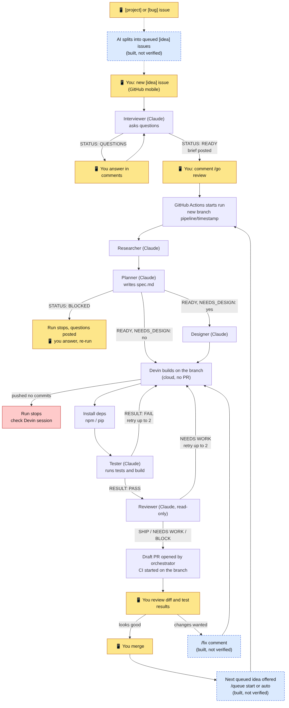

# 10. Running it from your phone, and the decision map

## The map

Source: `images/pipeline-map.mmd` (Mermaid). Edit it and re-render with `mmdc -i pipeline-map.mmd -o pipeline-map.png -w 1400 -b white`.

- **Yellow**: where you step in. Everything else is automatic.
- **Red**: a stop that needs you to look.
- **Blue dashed**: built but **not yet verified live**.
- Retries: a failed test or a `NEEDS WORK` review sends the work back to Devin, up to 2 times each.
- A `SHIP`, `NEEDS WORK` or `BLOCK` verdict all produce a draft PR. The decision to merge is always yours.

## What you can do from a phone today

| Need | Where |
|---|---|
| Submit an idea | GitHub app -> Issues -> New -> Idea |
| Answer the interviewer, approve | Comment on the issue (`defaults`, `/go plan`, `/go`) |
| Get notified | GitHub app notifications (Watch -> Custom) |
| See run progress | GitHub app -> Actions tab, or the report comment on the issue |
| Review a PR | GitHub app -> the PR -> Files changed |
| Merge | GitHub app -> Merge pull request |
| Cancel | Actions -> the run -> Cancel (and stop the Devin session in Devin) |

You need a computer only to run code locally (optional) and for one-time setup.

## Commands you can send from the phone

| Comment | Where | Does |
|---|---|---|
| `/go`, `/go plan`, `/go dev` | `[idea]` issue | Start the pipeline (full or partial) |
| `/fix <feedback>` | Pipeline PR | Devin applies it on the same branch; re-tests and re-reviews |
| `/status` | Issue or PR | Latest runs |
| `/stop` | Issue or PR | Cancel the running job (stop Devin separately) |
| `/queue start` | Issue or PR | Start the next queued idea |

`/fix`, `/status`, `/stop`, `/queue`, `[project]` and `[bug]` are written and locally tested but **not yet run live**. Expect to fix small things on first use.

## Still not built
- A visual preview per PR (use your host's preview deployments).
- End-to-end browser tests (add Playwright as its own idea).
- A second human reviewer, compliance review, monitoring. See [engineering practices](13-engineering-practices.md).
